# AirWSJT-X Dependency Graph

> Generated 2026-10-11 · Repository: cpicoto/AirWSJT-X · Version 0.3.0

---

## Architecture Overview

AirWSJT-X is a three-layer application:

| Layer | Technology | Entry Point |
|-------|-----------|-------------|
| Frontend | TypeScript / React (Tauri WebView) | `src/main.tsx` |
| Shell | Rust / Tauri 2.x | `src-tauri/src/lib.rs` |
| Sidecar | Python 3 | `sidecar/airwsjtx_bridge.py` |

Communication flows:
- **Frontend → Rust**: `invoke()` Tauri commands over IPC
- **Rust → Frontend**: `emit()` Tauri events over IPC
- **Rust → Python**: spawn sidecar process, write newline-delimited JSON to **stdin**
- **Python → Rust**: write newline-delimited JSON to **stdout** (consumed by Rust event loop)
- **Python → External**: HTTP (OpenSky REST, ADSBExchange REST), UDP (WSJT-X), TCP (Hamlib rotator), TCP (dump1090 SBS-1)

---

## Full Dependency Graph (Mermaid)

```mermaid
graph TD
    %% ── Entry Points ──────────────────────────────────────────────────────
    main_tsx["main.tsx<br/>(entry)"]
    app_tsx["App.tsx<br/>(desktop)"]
    mobile_tsx["MobileApp.tsx<br/>(mobile)"]

    %% ── Frontend: React Components ────────────────────────────────────────
    rotator_panel["RotatorPanel.tsx"]
    plane_lock_panel["PlaneLockPanel.tsx"]
    aircraft_accounts["AircraftAccounts.tsx"]

    %% ── Frontend: lib ─────────────────────────────────────────────────────
    lib_geo["lib/geo.ts"]
    lib_opensky["lib/opensky.ts"]
    lib_callsign["lib/callsign.ts"]
    lib_platform["lib/platform.ts"]

    %% ── Tauri / npm runtime ───────────────────────────────────────────────
    tauri_api_core["@tauri-apps/api/core<br/>(invoke)"]
    tauri_api_event["@tauri-apps/api/event<br/>(listen)"]
    react["react / react-dom"]

    %% ── Frontend wiring ───────────────────────────────────────────────────
    main_tsx --> lib_platform
    main_tsx --> app_tsx
    main_tsx --> mobile_tsx
    main_tsx --> react

    app_tsx --> tauri_api_core
    app_tsx --> tauri_api_event
    app_tsx --> rotator_panel
    app_tsx --> plane_lock_panel
    app_tsx --> aircraft_accounts
    app_tsx --> lib_geo

    mobile_tsx --> lib_geo
    mobile_tsx --> lib_opensky
    mobile_tsx --> lib_callsign
    mobile_tsx --> aircraft_accounts
    mobile_tsx --> tauri_api_core

    aircraft_accounts --> tauri_api_core

    lib_opensky --> tauri_api_core

    %% ── Rust Shell ────────────────────────────────────────────────────────
    rust_lib["lib.rs<br/>(Tauri builder)"]
    rust_credentials["credentials.rs<br/>(keyring / credentials)"]
    rust_mobile_aircraft["mobile_aircraft.rs<br/>(fetch_mobile_aircraft)"]
    rust_mobile_storage["mobile_storage.rs<br/>(Android secure storage)"]

    rust_lib --> rust_credentials
    rust_lib -->|"#cfg(mobile)"| rust_mobile_aircraft
    rust_lib -->|"#cfg(android)"| rust_mobile_storage
    rust_credentials -->|"#cfg(android)"| rust_mobile_storage

    %% ── Rust crates ───────────────────────────────────────────────────────
    crate_tauri["tauri 2"]
    crate_shell["tauri-plugin-shell 2"]
    crate_serde["serde / serde_json"]
    crate_tokio["tokio (full)"]
    crate_reqwest["reqwest 0.12<br/>(rustls-tls, gzip, json)"]
    crate_httpdate["httpdate"]
    crate_keyring["keyring 3<br/>(platform-native)"]
    crate_secure_storage["tauri-plugin-secure-storage<br/>(Android only)"]

    rust_lib --> crate_tauri
    rust_lib --> crate_shell
    rust_lib --> crate_serde
    rust_lib --> crate_tokio
    rust_credentials --> crate_keyring
    rust_mobile_aircraft --> crate_reqwest
    rust_mobile_aircraft --> crate_httpdate
    rust_mobile_storage --> crate_secure_storage

    %% ── Cross-layer: TS ↔ Rust ────────────────────────────────────────────
    tauri_api_core -- "invoke commands" --> rust_lib
    tauri_api_event -- "listen sidecar-message" --> rust_lib

    %% ── Cross-layer: Rust ↔ Python ────────────────────────────────────────
    rust_lib -- "spawn + stdin JSON" --> sidecar
    sidecar["airwsjtx_bridge.py<br/>(sidecar)"]
    sidecar -- "stdout JSON events" --> rust_lib

    %% ── Python sidecar → airwsjtx package ────────────────────────────────
    sidecar --> py_airscout
    sidecar --> py_callsign
    sidecar --> py_geo
    sidecar --> py_hamlib
    sidecar --> py_models
    sidecar --> py_supervisor
    sidecar --> py_tracking
    sidecar --> py_wsjtx_udp

    %% ── airwsjtx internal modules ─────────────────────────────────────────
    py_airscout["airscout.py<br/>(OpenSky/ADSBEx/dump1090 feeds)"]
    py_callsign["callsign.py<br/>(HamQTH/QRZ DB)"]
    py_geo["geo.py<br/>(scatter geometry)"]
    py_hamlib["hamlib_rotator.py<br/>(TCP rotator)"]
    py_models["models.py<br/>(AircraftSample/Track/Station)"]
    py_supervisor["supervisor.py<br/>(AirWSJTXSupervisor)"]
    py_tracker["tracker.py<br/>(AircraftTracker)"]
    py_tracking["tracking.py<br/>(track builder)"]
    py_wsjtx["wsjtx.py<br/>(WSJTXAdapter)"]
    py_wsjtx_udp["wsjtx_udp.py<br/>(UDP listener)"]
    py_psk["psk.py<br/>(AirscatterOperatingProfile)"]
    py_rotator["rotator.py<br/>(RotatorCommand/Controller)"]
    py_state_machine["state_machine.py<br/>(ContactSession)"]
    py_init["__init__.py"]

    py_supervisor --> py_models
    py_supervisor --> py_psk
    py_supervisor --> py_rotator
    py_supervisor --> py_state_machine
    py_supervisor --> py_tracker
    py_supervisor --> py_wsjtx

    py_tracker --> py_models
    py_tracking --> py_airscout
    py_tracking --> py_geo
    py_tracking --> py_models
    py_state_machine --> py_models

    py_init --> py_models
    py_init --> py_supervisor

    %% ── External services ─────────────────────────────────────────────────
    opensky_api["OpenSky REST API<br/>opensky-network.org"]
    adsbex_api["ADSBExchange REST API"]
    dump1090_tcp["dump1090 SBS-1 TCP<br/>127.0.0.1:30003"]
    wsjtx_udp_ext["WSJT-X UDP<br/>127.0.0.1:2237"]
    hamlib_tcp["Hamlib rotctld TCP"]
    opensky_oauth["OpenSky OAuth<br/>(auth.opensky-network.org)"]

    py_airscout --> opensky_api
    py_airscout --> adsbex_api
    py_airscout --> dump1090_tcp
    py_wsjtx_udp --> wsjtx_udp_ext
    py_hamlib --> hamlib_tcp
    rust_mobile_aircraft --> opensky_api
    rust_mobile_aircraft --> opensky_oauth
    lib_opensky --> opensky_api
```



---

## 1. Python Layer

### Internal module import map

| Module | Imports from airwsjtx |
|--------|----------------------|
| `sidecar/airwsjtx_bridge.py` | `airscout`, `callsign`, `geo`, `hamlib_rotator`, `models`, `supervisor`, `tracking`, `wsjtx_udp` |
| `supervisor.py` | `models`, `psk`, `rotator`, `state_machine`, `tracker`, `wsjtx` |
| `tracking.py` | `airscout` (Aircraft), `geo`, `models` |
| `tracker.py` | `models` |
| `state_machine.py` | `models` |
| `__init__.py` | `models`, `supervisor` |
| All others (`geo`, `models`, `psk`, `rotator`, `wsjtx`, `wsjtx_udp`, `hamlib_rotator`, `callsign`) | stdlib only |

### Third-party packages

| Package | Used in | Purpose | Pinned? |
|---------|---------|---------|---------|
| *(none currently)* | — | All network I/O uses `urllib.request` and `socket` from stdlib | N/A |

**All Python I/O is stdlib** (`urllib`, `socket`, `struct`, `threading`). No `requests`, `pyserial`, or other third-party packages are required at runtime.

`pyinstaller` is used at **build time** (see `src-tauri/binaries/`) to bundle the sidecar but is not imported in any source file.

### Circular dependencies
**None detected.** The dependency graph is a strict DAG:
`sidecar → supervisor → {tracker, state_machine, ...} → models`

---

## 2. TypeScript / React Layer

### Component import map

| File | Imports |
|------|---------|
| `main.tsx` | `App`, `MobileApp`, `lib/platform`, `react`, `index.css` |
| `App.tsx` | `RotatorPanel`, `PlaneLockPanel`, `AircraftAccounts`, `lib/geo`, `@tauri-apps/api/core`, `@tauri-apps/api/event` |
| `MobileApp.tsx` | `AircraftAccounts`, `lib/geo`, `lib/opensky`, `lib/callsign`, `@tauri-apps/api/core` |
| `AircraftAccounts.tsx` | `@tauri-apps/api/core` |
| `RotatorPanel.tsx` | `react` |
| `PlaneLockPanel.tsx` | `react` |
| `lib/opensky.ts` | `@tauri-apps/api/core` |
| `lib/geo.ts` | *(none)* |
| `lib/callsign.ts` | *(none — likely stdlib fetch)* |
| `lib/platform.ts` | *(none)* |

### Dependency hubs vs leaves

| Role | Files |
|------|-------|
| **Hubs** (imported by many) | `lib/geo.ts` (3 importers), `AircraftAccounts.tsx` (2 importers), `lib/opensky.ts` (2 importers) |
| **Leaves** (import nothing internal) | `lib/geo.ts`, `lib/callsign.ts`, `lib/platform.ts`, `RotatorPanel.tsx`, `PlaneLockPanel.tsx` |

### npm dependencies

**Runtime:**

| Package | Version | Role |
|---------|---------|------|
| `react` | ^19.1.0 | UI framework |
| `react-dom` | ^19.1.0 | DOM rendering |
| `@tauri-apps/api` | ^2.5.0 | IPC — `invoke` / `listen` |
| `@tauri-apps/plugin-shell` | ^2.2.1 | Sidecar spawn (shell plugin JS side) |

**Dev:**

| Package | Version | Role |
|---------|---------|------|
| `vite` | ^6.3.5 | Bundler / dev server |
| `@vitejs/plugin-react` | ^4.5.2 | React fast-refresh |
| `typescript` | ^5.8.3 | Type checker |
| `@tauri-apps/cli` | ^2.5.0 | `tauri dev` / `tauri build` |
| `@playwright/test` | ^1.64.0 | E2E tests |
| `@types/react` | ^19.1.6 | React type stubs |
| `@types/react-dom` | ^19.1.6 | ReactDOM type stubs |

---

## 3. Rust Layer

### Crates

| Crate | Version | Role |
|-------|---------|------|
| `tauri` | 2 | App framework, window management, IPC |
| `tauri-plugin-shell` | 2 | Sidecar spawn + stdin/stdout pipes |
| `serde` + `serde_json` | 1 | JSON serialization for IPC messages |
| `tokio` (full) | 1 | Async runtime for sidecar I/O loop |
| `reqwest` | 0.12 (rustls-tls) | HTTP for `mobile_aircraft.rs` (OpenSky OAuth + REST) |
| `httpdate` | 1 | HTTP date parsing for caching headers |
| `keyring` | 3 | OS credential store (Keychain / DPAPI / Secret Service) |
| `tauri-plugin-secure-storage` | =1.5.0 | Android-only credential store |
| `tauri-build` | 2 | Build-time code generation |

### Internal module relationships

```
lib.rs  ──► credentials.rs  ──► [keyring]
        ──► mobile_aircraft.rs ──► [reqwest, httpdate]  (cfg: mobile)
        ──► mobile_storage.rs  ──► [tauri-plugin-secure-storage]  (cfg: android)
credentials.rs ──► mobile_storage.rs  (cfg: android, for load/store)
```

`main.rs` is a thin binary entry point that calls `lib.rs::run()`.

---

## 4. Cross-Layer Communication

### Desktop (default)

```
TypeScript                 Rust (lib.rs)              Python (airwsjtx_bridge.py)
──────────────────────     ────────────────────────    ───────────────────────────
invoke("send_to_sidecar")  →  write stdin JSON      →  dispatch RPC handler
listen("sidecar-message")  ←  emit("sidecar-message")  ←  print() JSON to stdout

invoke("save_source_credentials")  →  credentials.rs  →  write_credentials JSON to sidecar stdin
invoke("get_source_credentials_status")  →  credentials.rs  (reads keyring, no sidecar round-trip)
invoke("set_source_poll_interval")  →  credentials.rs  →  write JSON to sidecar stdin
invoke("get_source_rate_limit_status")  →  SidecarState.rate_limits (in-memory cache)
```

### Mobile (iOS / Android)

```
TypeScript                 Rust (lib.rs)              External
──────────────────────     ─────────────────────       ─────────
invoke("fetch_mobile_aircraft")  →  mobile_aircraft.rs  →  OpenSky OAuth + REST
lib/opensky.ts fetch()     →  (direct browser fetch)  →  OpenSky REST
lib/callsign.ts            →  (direct browser fetch)  →  callsign DB CDN
```

On mobile the Python sidecar is **not spawned**. The frontend fetches aircraft directly (either via Rust command or `lib/opensky.ts`).

---

## 5. Analysis

### Concerning coupling

1. **Dual OpenSky paths** — Aircraft data is fetched via three different paths depending on context:
   - Desktop: Python `OpenSkyFeed` in `airwsjtx_bridge.py`
   - Mobile Rust: `mobile_aircraft.rs` (with OAuth token management)
   - Mobile TS: `lib/opensky.ts` (direct `fetch()`, no auth)
   
   This means OpenSky rate-limit logic and response parsing is duplicated across all three layers, creating a maintenance risk when the OpenSky API changes.

2. **`lib/opensky.ts` imports `@tauri-apps/api/core`** — The `fetchNativeAircraft` function (line 180) calls `invoke()`, making this utility module Tauri-specific and untestable outside Tauri. The pure fetch functions above it have no such dependency and could be split out.

3. **`credentials.rs` calls `mobile_storage.rs`** — Cross-module coupling under `cfg(android)` creates a conditional dependency that is easy to break when refactoring either file.

### Largest dependency hubs

| Hub | Dependents |
|-----|-----------|
| `airwsjtx/models.py` | 7 modules depend on it (supervisor, tracker, tracking, state_machine, __init__, tracking, bridge) |
| `@tauri-apps/api/core` | 4 TS files (`App.tsx`, `MobileApp.tsx`, `AircraftAccounts.tsx`, `lib/opensky.ts`) |
| `lib/geo.ts` | `App.tsx`, `MobileApp.tsx` |
| `airwsjtx/airscout.py` | `sidecar` (direct) + `tracking.py` |

### Opportunities to simplify

1. **Consolidate aircraft fetching** — Create a single `AircraftSource` abstraction. On mobile the Rust command should be the single fetch path; remove the direct `fetch()` from `lib/opensky.ts` or gate it to desktop-only.

2. **Split `lib/opensky.ts`** — Separate `Aircraft` type + pure parsing functions from the `invoke()`-dependent `fetchNativeAircraft`. This makes the types reusable in tests without Tauri.

3. **`airwsjtx_bridge.py` is very large** (~54 KB). Splitting RPC dispatch, source management, and WSJT-X handling into separate files would improve maintainability and testability.

4. **Pin Python build dependencies** — `pyinstaller` (used in CI to bundle the sidecar) is not pinned anywhere. Add a `requirements-build.txt` or `pyproject.toml` with `pyinstaller` pinned to avoid build breakage on version bumps.

5. **`tauri-plugin-secure-storage = "=1.5.0"` is hard-pinned** — This will become a problem when Tauri 2.x releases security patches to the plugin. Track https://github.com/tauri-apps/plugins-workspace and upgrade when compatible.

### Missing / implicit dependencies

| Dependency | Where | Status |
|-----------|-------|--------|
| `pyinstaller` | CI bundling | Not pinned in any manifest |
| Python ≥ 3.10 | `airwsjtx/` uses `match`-style patterns implicitly via type hints | Not declared |
| `dump1090` / `rtl-sdr` | `airwsjtx_bridge.py` Dump1090Feed | Runtime requirement, not documented in README |
| Hamlib `rotctld` | `hamlib_rotator.py` | Runtime requirement, not documented |
| OpenSky OAuth endpoint | `mobile_aircraft.rs` hard-codes `auth.opensky-network.org` | URL should be configurable |

---

*This file was generated automatically. Re-run the analysis after significant refactoring.*
